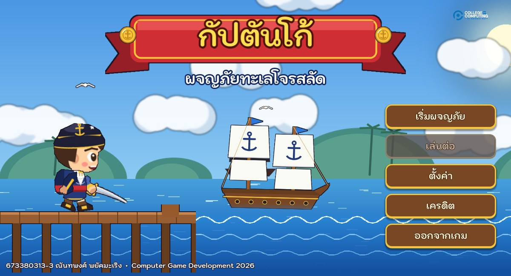
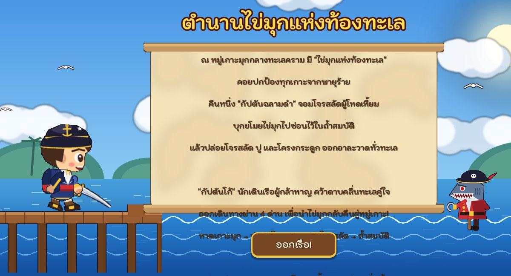
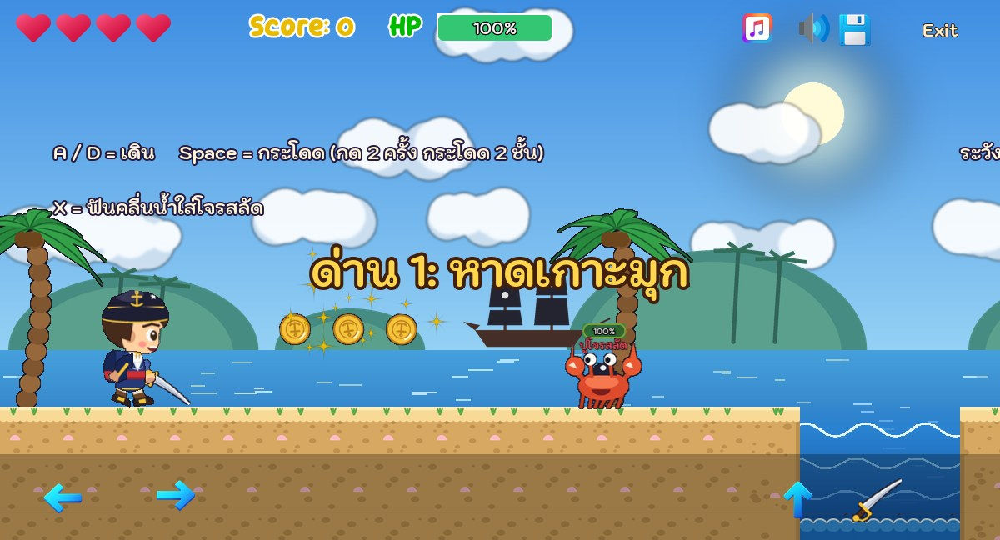
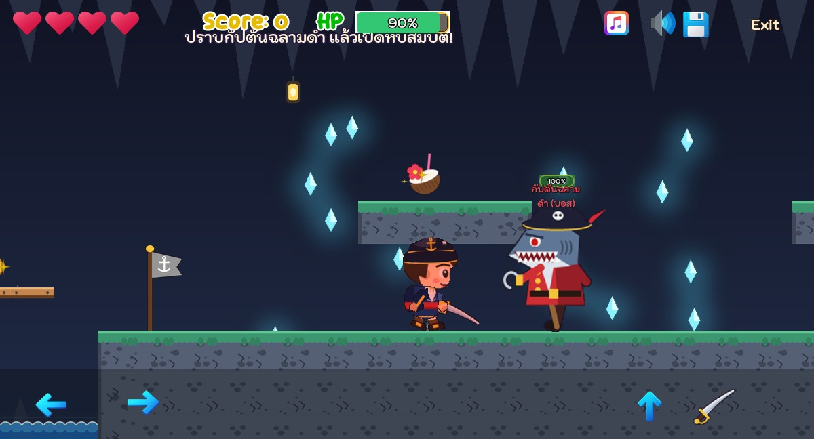

# กัปตันโก้ ผจญภัยทะเลโจรสลัด (Captain Go: Pirate Sea Adventure)

แบบฝึกหัดที่ 4 สร้างเกมแบบ 2D Platform Side-Scrolling วิชา Computer Game Development

- **รหัสนักศึกษา:** 673380313-3
- **ชื่อ-สกุล:** ณันทพงศ์ พยัคมะเริง

## Play / Demo

- [Play Game (GitHub Pages)](https://nantapongpa-a11y.github.io/2D-Platformer-Starter-Kit/)
- [Clip Demo VDO](https://youtu.be/xxxx) <!-- TODO: ใส่ลิงก์คลิปเล่นเกม ~2 นาที -->

 
 

## Game Story

ณ หมู่เกาะมุกกลางทะเลคราม มี **"ไข่มุกแห่งท้องทะเล"** คอยปกป้องทุกเกาะจากพายุร้าย
แต่คืนหนึ่ง **กัปตันฉลามดำ** จอมโจรสลัดผู้โหดเหี้ยม บุกขโมยไข่มุกไปซ่อนไว้ในถ้ำสมบัติ
แล้วปล่อยลูกเรือโจรสลัด ปูโจรสลัด และโครงกระดูก ออกอาละวาดไปทั่วทะเล

**กัปตันโก้** นักเดินเรือหนุ่มผู้กล้าหาญ คว้าดาบคลื่นทะเลคู่ใจ ออกเดินทางผ่าน 4 ด่าน
เพื่อปราบกัปตันฉลามดำ และนำไข่มุกกลับคืนสู่หมู่เกาะ

| ด่าน | ชื่อ | รายละเอียด |
|---|---|---|
| 1 | หาดเกาะมุก | ชายหาด ต้นมะพร้าว ปูโจรสลัด เม่นทะเล ไม้กระดานข้ามทะเล |
| 2 | ท่าเรือโจรสลัด | ท่าเรือไม้ ลังไม้ ถังไม้ สมอเหวี่ยง จุดเกิดศัตรู |
| 3 | บนเรือโจรสลัด | ดาดฟ้าเรือ เสากระโดงธงโจรสลัด โครงกระดูกโจรสลัด (ฉากพระอาทิตย์ตก) |
| 4 | ถ้ำสมบัติฉลามดำ | ถ้ำคริสตัล บอส **กัปตันฉลามดำ** ยิงลูกปืนใหญ่ หีบสมบัติเปิดได้เมื่อปราบบอสแล้ว |

## สิ่งที่สร้างเอง

ภาพ เพลง และเสียงทั้งหมดในเกมสร้างเองด้วยโค้ดในโฟลเดอร์ [`scripts/`](scripts)

| สิ่งที่สร้าง | รายละเอียด | ไฟล์ |
|---|---|---|
| ตัวละคร **กัปตันโก้** | หมวกกัปตันมีสมอทอง เสื้อโค้ตกรมท่า ผ้าคาดเอวแดง ถือดาบโค้ง ใช้ rig Skeleton2D ทำท่ายืน เดิน กระโดด ฟันดาบ | `Assets/Sea/captain_go.png`, `cutlass.png` |
| ศัตรู 4 แบบ | โจรสลัด, ปูโจรสลัด, โครงกระดูกโจรสลัด และบอส **กัปตันฉลามดำ** (มีภาพเดิน 6 เฟรม) | `Assets/Sea/pirate_*.png`, `boss_black_shark.png` |
| อาวุธและกระสุน | ดาบคลื่นทะเลยิงลูกบอลน้ำ / บอสยิงลูกปืนใหญ่ | `water_orb.png`, `cannonball.png` |
| ไอเทม | เหรียญทองโจรสลัด (+คะแนน), น้ำมะพร้าว (+20 HP), **เปลือกหอยวายุ** (วิ่งเร็ว + กระโดดสูง 8 วินาที) | `doubloon.png`, `coconut.png`, `wind_conch.png` |
| กับดัก | เม่นทะเล, สมอเหวี่ยง (AnimationPlayer + สุ่มเวลา) และตกทะเลเสียชีวิต | `Scenes/Prefabs/sea_urchin.tscn`, `anchor_trap.tscn` |
| ฉากและ TileSet | TileSet ทราย / ไม้ / หิน พร้อม Collision Polygon, ไม้กระดานกระโดดทะลุขึ้นได้, ท้องฟ้ากลางวัน พระอาทิตย์ตก ถ้ำ และทะเลแบบ Parallax | `Assets/Sea/sea_tiles.png`, `Scenes/Prefabs/sea_tile_set.tres` |
| ด่าน 4 ด่าน | สร้างจากโค้ดเป็น TileMapLayer จริง (เปิดแก้ใน Godot ได้) | `scripts/make_levels.py`, `Scenes/Levels/level_0*.tscn` |
| เพลง 3 เพลง | **Captain Go Theme** (หน้าเริ่มเกม, sea shanty 6/8), **Sea Adventure** (ด่าน 1-3, jig 6/8), **Black Shark Battle** (ด่านบอส) แต่งโน้ตเอง เครื่องดนตรี fiddle / accordion / เบส / กลอง / เสียงคลื่น | `Assets/Sound/*.ogg`, `scripts/make_music.py` |
| เสียงเอฟเฟกต์ | กระโดด เก็บเหรียญ โดนโจมตี ฟันดาบ ตกน้ำ เช็กพอยต์ ปืนใหญ่ ผ่านด่าน | `Assets/Sound/FX/sea_*.wav` |
| หน้าจอ | หน้าเริ่มเกม (ทะเล เรือ นกนางนวลเคลื่อนไหว), เนื้อเรื่อง (พิมพ์ทีละตัวอักษร), ตั้งค่า, เครดิต, เรือล่ม, ชนะแล้ว และธีมปุ่มไม้ขอบทอง | `Scenes/Levels/*.tscn`, `Scenes/Prefabs/theme.tres` |

สร้างไฟล์ใหม่ได้ด้วยคำสั่ง

```bash
python scripts/make_art.py
python scripts/make_music.py
python scripts/make_levels.py
```

## Game Play ที่ปรับปรุง

- ผู้เล่นมี HP 100 และ 4 ชีวิต แสดงบนหน้าจอ
- โดนศัตรู กับดัก หรือลูกปืนใหญ่ จะเสีย HP (ไม่ตายทันที) HP หมดหรือตกทะเลจะเสีย 1 ชีวิต
- ธง **เช็กพอยต์** ทำให้เกิดใหม่กลางด่าน
- ฆ่าศัตรูได้คะแนน ปราบบอสได้โบนัส +50
- กระโดดได้ 2 ชั้น และกล้องไม่เลื่อนออกนอกด่าน

## วิธีเล่น

| ปุ่ม | การทำงาน |
|---|---|
| A / D หรือ ลูกศรซ้าย-ขวา | เดิน |
| Space / W / ลูกศรขึ้น | กระโดด (กด 2 ครั้ง = กระโดด 2 ชั้น) |
| X | ฟันดาบคลื่นน้ำ |
| ปุ่มบนจอ | เล่นบนมือถือ / เว็บ |

---

# 2D Platformer Starter Kit (ต้นฉบับ)

This starter kit provides all the essential mechanics needed to build a complete 2D platformer game in Godot 4.7. It is designed as a hands-on learning resource for students taking the **Computer Game Development** course at the **College of Computing, Khon Kaen University**.

## Preview


- [Game Preview](https://computingkku.github.io/2D-Platformer-Starter-Kit/)


## Features

- **Game Menu** — A simple main menu scene (`Menu.tscn`) with Start and Exit options, so players can launch into the game or quit cleanly.
- **Mobile & Web Design** — On-screen touch controls are included, allowing the game to be played on phones, tablets, and browsers without a keyboard.
- **Platformer Controller** — Responsive horizontal movement and jumping with double jump support, configurable directly from the Godot Inspector.
- **Weapon System** — Shoot fireball projectiles with physics-based bouncing and a configurable lifetime. Bullets can defeat enemies and add to the player's score.
- **Enemy AI** — Enemies use a reusable state-driven AI base class with patrol, chase, attack, rest, damage, and death behaviors. They reverse direction when hitting walls or falling off ledges, detect the player with raycasts, and adapt their behavior by enemy type such as ping-pong, melee, ranged, defensive, and boss variants. Defensive and boss enemies can enter a low-health REST state to retreat and regenerate HP before resuming combat.
- **Enemy Spawner** — A reusable spawner that generates enemies over time with configurable speed, respawn delay, and maximum instance limits.
- **Animated Player** — Idle, walk, jump, and attack animations driven by state logic; sprite flips automatically based on movement direction.
- **Particle Effects** — Running particle trails, death particles, and damage feedback (red flash) for juicier game feel.
- **Damage & Health System** — Player takes damage on enemy contact with knockback and temporary invincibility frames. HP bar and life count are displayed in the UI.
- **Save & Load** — Save and load game progress (position, score, lives, and settings) using JSON files.
- **Sound & Music Toggle** — Persistent audio settings saved to a config file, with on-screen mute/unmute buttons.
- **Score System** — Collect coins or defeat enemies to increase your score; UI updates in real time through the game manager.
- **Demo Levels** — Two hand-crafted levels that introduce platformer design patterns and progressively challenge the player.
- **Level Management** — Clean scene transitions between levels using an autoload transition manager.
- **Beginner-Friendly Code** — Every script is documented and structured to be easy to read, modify, and extend.

## Getting Started

1. Open the project in [Godot 4.7](https://godotengine.org/) or later.
2. Press **F5** or click **Play** to run the main menu.
3. Use **A/D** or **Left/Right** to move, **Space** to jump, and **X** to shoot.
4. On mobile or web, use the on-screen buttons at the bottom of the screen.
5. Collect coins, defeat enemies, avoid traps, and reach the door to finish each level.

## Project Structure

```
Scenes/
├── Actors/           # Player, enemies, and spawners
├── Levels/           # Level scenes, base level template, and UI
├── Managers/         # GameManager, SceneTransition, AudioManager
└── Prefabs/          # Reusable objects (bullet, coin, potion, door, button)

Assets/
├── Fonts/            # Custom fonts
├── Icons/            # UI icons
├── Sound/            # BGM and SFX
├── Spritesheet/      # Character and tile sprites
└── Textures/         # Particle and effect textures
```

## Controls

| Input | Action |
|-------|--------|
| A / Left Arrow | Move left |
| D / Right Arrow | Move right |
| Space / S | Jump |
| X | Shoot |
| On-screen buttons | Mobile and web touch controls |

## Inspector Tips

- **Player**: Toggle `double_jump` to enable double jump. Adjust `move_speed`, `jump_force`, `shoot_cooldown_time`, and `bullet_lifetime` directly in the inspector.
- **Enemy Spawner**: Configure `enemy_scenes`, `speed_range`, `respawn_time`, and `max_instance` to control enemy behavior and density.
- **Bullet**: Adjust `speed` and `lifetime` to change projectile feel.

## Developer & Contributor Guide

This project is structured to be beginner-friendly, but it is also designed to scale into a more advanced prototype or classroom project. The goal is to keep gameplay logic readable while still supporting modular extension.

### Core Architecture

- **Player**: controlled in `Scenes/Actors/player.gd` and driven by movement, jumping, shooting, damage, and animation state.
- **Enemy Base Class**: implemented in `Scenes/Actors/enemy.gd` and acts as the shared abstract AI controller for all enemies.
- **Level Logic**: basic platformer scenes and gameplay flow are handled in `Scenes/Levels/`.
- **Managers**: global systems such as game progression, scene transitions, and audio are kept in `Scenes/Managers/`.
- **Prefabs**: reusable gameplay objects such as bullets, doors, coins, and pickups live in `Scenes/Prefabs/`.

### Enemy AI Design

The enemy system uses an abstract base class with multiple behaviors rather than a single hardcoded script. This keeps each enemy consistent while still allowing different archetypes.

#### State Model

Supported enemy states typically include:

- `IDLE` — waits before acting
- `WALK` — normal movement
- `PATROL` — moves in a direction until a condition changes
- `CHASE` — follows the player when nearby
- `ATTACK` — performs attack behavior or contact damage
- `REST` — defensive recovery state used when injured
- `DAMAGED` — short reaction state after taking damage
- `DEAD` — death and cleanup

#### Type Model

Enemy types are used to tune behavior patterns without rewriting the full AI flow:

- `DUMMY` — weak or passive enemy
- `PINGPONG` — reverses direction between limits or edges
- `NEAR` — aggressive melee enemy that stays close to the player
- `FAR` — attacks from a moderate distance or tracks with a slower rhythm
- `DEFENSE` — defensive enemy that retreats and heals when low on HP
- `BOSS` — stronger enemy with longer recovery and more advanced combat logic

### Movement and Terrain Rules

The base AI should handle the following rules consistently:

- Move in the current `direction` value unless a state override is active.
- Reverse when colliding with a wall or reaching an edge.
- Keep logic separated from player-facing logic so wall-turn behavior is not overwritten by chase logic.
- Respect ground collision and raycast checks for platform boundaries.
- Prevent the enemy from turning back too aggressively when it is already in a valid chase or attack loop.

### Restoration and Low-HP Recovery

The `REST` state is important for defensive enemies and bosses:

- If enemy type is `DEFENSE` or `BOSS`, low HP can trigger `REST`.
- In `REST`, the enemy may retreat from the player instead of attacking directly.
- The enemy regains HP over time using a configured regeneration rate.
- Recovery ends when HP is restored above a threshold such as 60% of max HP.
- While in `REST`, attack actions should be paused until recovery completes.

### Extending the Enemy System

To add a new enemy variation:

1. Create a new scene based on the enemy base prefab or a shared enemy template.
2. Extend the base enemy script or override only the behavior hooks you need.
3. Set a compatible enemy type and state logic.
4. Tune values such as speed, chase range, attack range, and HP in the Inspector.
5. Test terrain turns, player detection, and damage flow on a small level before scaling up.

### Good Contribution Practices

- Keep scripts readable and modular.
- Prefer clear English comments and function documentation for educational projects.
- Separate movement logic from AI decision logic to avoid state conflicts.
- Validate enemy collisions and raycast behavior on several platform layouts.
- Avoid hardcoding values in multiple places; use exported variables where possible.
- Test both idle and combat states before merging a change.

### Suggested Workflow for Contributors

1. Read the base enemy script before editing specialized enemies.
2. Understand the state transition before changing attack or rest behavior.
3. Add a small test scenario or level to validate edge cases.
4. Verify that movement, wall-turning, and player detection still work together.
5. Keep commits focused on one feature area at a time.

### Documentation Style

This repository is intended for learning. When editing scripts or documentation:

- Write comments in clear English.
- Explain the purpose of variables and functions.
- Keep implementation detail practical and beginner-friendly.
- Prefer concise naming and readable flow over clever but opaque code.

### Contribution Notes

This project is suitable for course assignments, classroom demos, and student projects. Contributions should remain approachable for learners while still demonstrating professional game design patterns.

## Saving

- Press the **Save** button in the top-right corner to save your progress.
- The game saves the player's position, score, lives, and audio settings.

## Credits

**Original Developer**
- [AdilDevStuff](https://github.com/AdilDevStuff) — [2D-Platformer-Starter-Kit](https://github.com/AdilDevStuff/2D-Platformer-Starter-Kit)

**2D Assets**
- [Kenney.nl](https://www.kenney.nl/)
- [craftpix.net](https://craftpix.net/)
- [Ravenmore](https://ravenmore.itch.io/)
- [Icons8.com](https://icons8.com)

**Sound Effects**
- GDFXR (Sfxr plugin for Godot)

**Modified for Educational Use By**
- Wachirawut Thamviset
- College of Computing, Khon Kaen University
